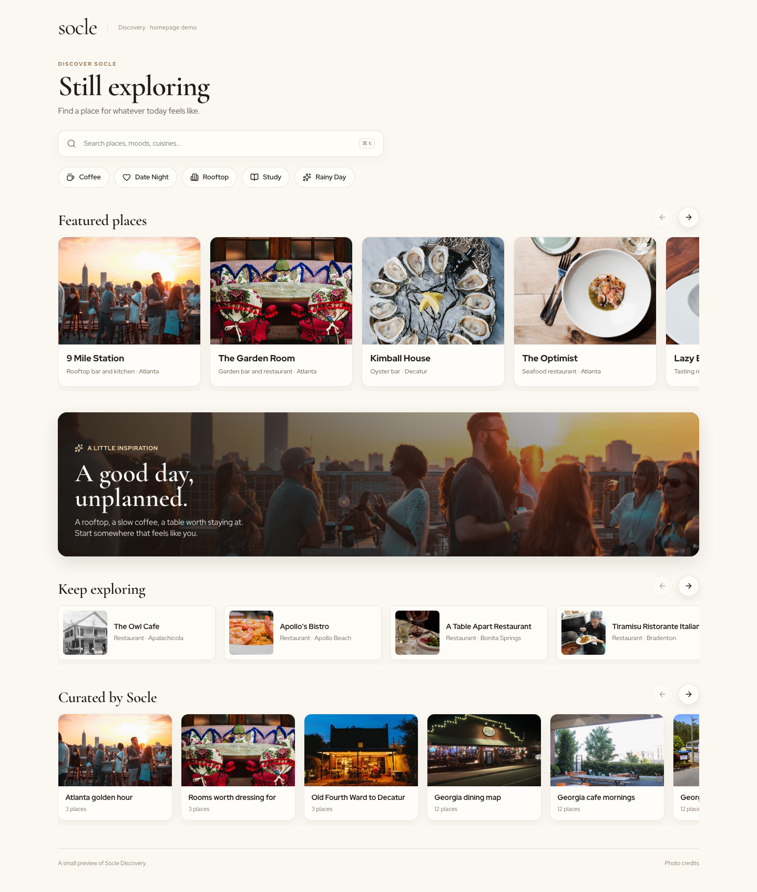

# socle discovery demo



socle is a project i'm building around discovering places and understanding what people enjoy about them. i have two sides to socle: the discovery side helps people find cafés, restaurants, hotels, and other hospitality places. the business side helps owners understand feedback from their customers.

the full project has features including saving places, creating custom lists, social features like messaging, and being able to send locations you love like reels. there are also taste profiles that develop from your activity. right now, saving places, adding them to lists, and verified visits update your taste profile. sending places and reacting to messages are social features, but they don't affect taste yet. i wanted those features to connect, so finding a place, saving it for later, and sharing it with someone feel like parts of the same experience.

## one thing i've been working on

one challenge i struggled with has been making everything work comfortably on a phone using xcode. during testing, navigation could get stuck (AND I STILL DONT KNOW WHY!!!) and the separate feature introductions i added SO LONG AGO kept interrupting the experience. i replaced those introductions with one onboarding flow at the beginning, instead of like 5 independent ones, and tested the layouts and touch controls.

## try the demo

the public demo, the one in this repo, shows the discovery homepage. you can explore its layout, place cards, and collections without creating an account, on your own localhost. it's a limited preview, however, so account features and individual place pages aren't included. everything here runs on sample data and doesn't connect to anyone's real information.

i'd especially appreciate feedback on whether the page makes sense to someone seeing socle for the first time.

## try the full platform

also, if you haven't already, check out the REAL socle discovery and business platform at [socle.pages.dev](https://socle.pages.dev/).

if you're from stardance, open the sign-in/create-account page and click **testers** in the bottom left. when it asks where you're from, enter **stardance**. this creates a temporary testing account with free access for 24 hours. the account includes a **stardance testers** workplace so you can explore the business side too. this is separate from the standalone demo in this repo.

have fun!!

## why this is a demo

the full socle app lives in a private repo. it includes unfinished product work, account and business features, internal services, and integrations that should not be exposed in a small public preview. keeping this demo separate makes it easier to try and understand, while keeping the wider product and its development history private.

## run it on your computer

you'll need node.js 22 or newer. from this folder, run:

```sh
npm install
npm run dev
```

then open [http://127.0.0.1:3044](http://127.0.0.1:3044).

to make a production build locally:

```sh
npm run build
npm start
```

## what's in the demo

- a responsive discovery homepage
- sample place and collection shelves
- search and mood filters that work with the sample content
- keyboard search shortcut, local-time greeting, and reduced-motion support
- touch scrolling and previous/next controls for the shelves

## what's not in the demo

there's no sign-in, account, navigation menu, place detail page, database, api, location tracking, taste scoring, analytics, or business dashboard. the cards are previews, and the sample places and collections are included just to make the page useful to explore.

## photos and brand

photo sources are listed in `PHOTO-CREDITS.md` and in the page's photo credits dialog. the photos belong to their credited owners. this repo also does not grant permission to reuse socle's name, logo, or other brand assets.
